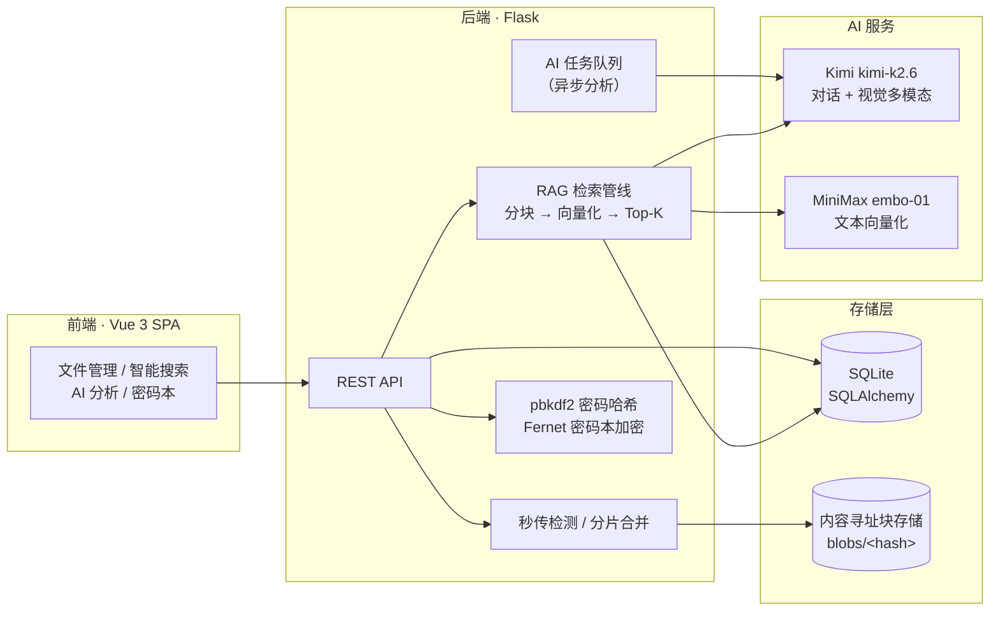
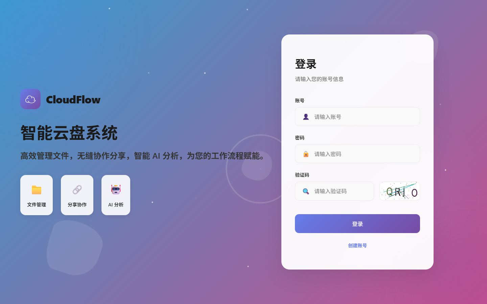
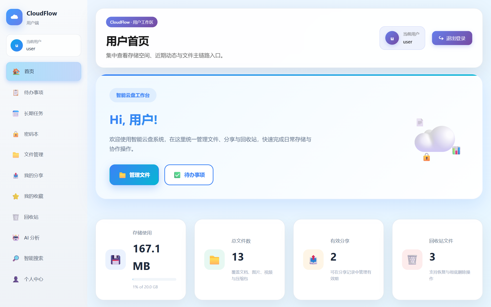
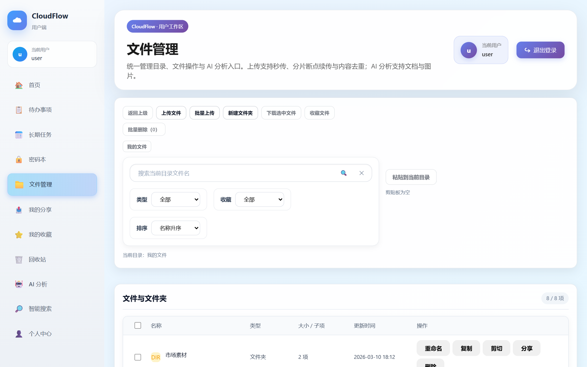
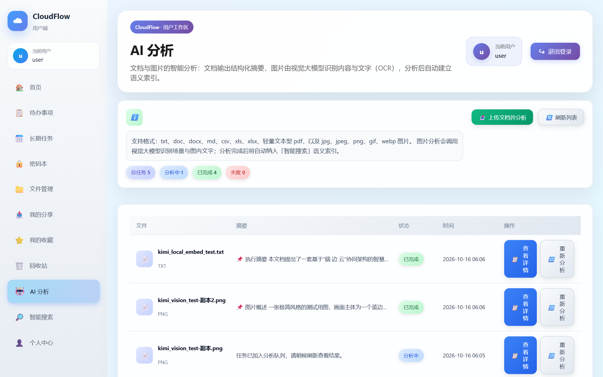

# CloudFlow 云流端

> 面向个人与团队的智能云盘系统：内容寻址存储 + 语义检索 + 多模态 AI 分析


[](https://github.com/XiaoMa-77/cloudflow/actions/workflows/ci.yml)

CloudFlow 是一个前后端分离的云盘系统，在传统网盘能力（文件管理、分享、回收站、待办）之上，引入了三项核心智能化能力：

- **去重秒传与分片续传**：SHA-256 内容寻址存储，相同文件秒级入库；大文件分片上传、断点续传
- **RAG 语义搜索与智能问答**：文档向量化后支持自然语言检索，并基于检索片段生成带引用的答案
- **多模态 AI 分析**：文档深度解析 + 图片视觉理解（OCR / 场景描述），分析结果自动进入语义索引

## 系统架构



## 功能特性

### 登录与工作台

图形验证码登录，工作台汇总存储用量、文件动态与待办事项。





### 文件管理：秒传与分片续传

- 上传前计算 SHA-256，服务端已有相同内容时**秒级完成**（不重复占用存储）
- 大文件自动切换**分片上传**（默认 4MB/片），网络中断后可断点续传，分片失败自动重试
- 内容寻址存储（`blobs/<hash前2位>/<hash>`），引用计数管理，多人存同文件只占一份空间



### 语义搜索与智能问答（RAG）

- 文档在 AI 分析完成后自动建立语义索引（700 字分块 / 80 字重叠）
- 支持**自然语言检索**：如搜「牛生病能不能提前发现」可命中包含「奶牛疾病预警」的文档（实测相关度 0.447）
- 可选开启 **RAG 问答**：基于检索片段生成自然语言答案，并标注引用文件
- 向量化默认走 **MiniMax embo-01**（非对称模型，入库 / 检索向量自动区分）；未配置时自动降级为内置本地向量化（离线可用）
- 索引记录向量来源，切换向量服务后旧索引自动隔离，重建即可完成迁移

### 多模态 AI 分析

- 文档（txt / md / doc / docx / csv / xls / xlsx / pdf）：深度解析，输出结构化分析报告（执行摘要 → 核心解析 → 行动建议）
- 图片（jpg / png / gif / webp）：视觉大模型识别场景要素与图内文字（OCR），输出标签建议
- 分析异步执行（任务队列），完成后自动进入语义索引，图片同样可被语义搜索命中



### 安全与其他

- 密码 **pbkdf2:sha256** 哈希存储，历史明文密码登录时自动升级
- 密码本静态加密（**Fernet**），密钥仅存于 `.env`
- 回收站（删除 / 恢复 / 彻底删除，自动清理索引）、我的分享、我的收藏、待办事项、长期任务
- 管理端：用户管理、存储配额、操作审计

## 技术栈

| 层 | 技术 |
| --- | --- |
| 后端 | Python / Flask / SQLAlchemy / SQLite |
| 前端 | Vue 3 / Vite / Element Plus / Pinia |
| AI 服务 | Kimi `kimi-k2.6`（Moonshot API，对话 + 视觉多模态） |
| 向量化 | MiniMax embo-01（原生协议适配）/ 内置 n-gram 特征哈希（默认兜底），亦支持任意 OpenAI 兼容 embeddings 服务 |
| 安全 | hashlib.pbkdf2_hmac / cryptography.Fernet |

## 快速开始

### 环境要求

- Python 3.10+
- Node.js 18+（构建前端）

### 1. 配置并启动后端

```bash
cd cloudflow/backend
pip install -r requirements.txt
# 编辑 .env（见下方配置说明）
python app.py
```

后端默认运行在 `http://localhost:8080`，启动时自动初始化数据库并创建演示账号（`user` / `123456`，管理端 `admin` / `123456`）。

### 2. 构建前端

```bash
cd cloudflow/admin
npm install
npm run build
```

构建产物由后端托管，直接访问 `http://localhost:8080` 即可（开发模式可用 `npm run dev`）。

### `.env` 配置说明

配置文件位于 `cloudflow/backend/.env`（已被 `.gitignore` 排除，密钥不入仓库）：

```ini
# 对话与视觉模型（kimi-k2.6 为原生多模态，两者共用）
MOONSHOT_API_KEY=sk-xxxx
AI_MODEL=kimi-k2.6
AI_VISION_MODEL=kimi-k2.6

# 可选：外部向量服务，留空则使用内置本地向量化
# MiniMax（原生协议，embo-01 为非对称模型，自动区分入库/检索向量）：
EMBEDDING_BASE_URL=https://api.minimaxi.com/v1
EMBEDDING_API_KEY=sk-api-xxxx
AI_EMBEDDING_MODEL=embo-01
EMBEDDING_PROVIDER=minimax
# OpenAI 兼容服务（如 SiliconFlow）则省略 EMBEDDING_PROVIDER：
# EMBEDDING_BASE_URL=https://api.siliconflow.cn/v1
# EMBEDDING_API_KEY=sk-xxxx
# AI_EMBEDDING_MODEL=BAAI/bge-m3

# 密码本静态加密主密钥（python -c "from cryptography.fernet import Fernet;print(Fernet.generate_key().decode())"）
PASSWORD_BOOK_KEY=your-fernet-key
```

> 提示：配置修改后需重启后端生效；切换向量服务后在「智能搜索」页点击「重建全部索引」完成迁移。

## 核心接口

| 方法 | 路径 | 说明 |
| --- | --- | --- |
| POST | `/api/auth/login` | 登录（图形验证码 + 哈希校验） |
| POST | `/api/files/upload/check` | 秒传检测（SHA-256 命中即完成） |
| POST | `/api/files/upload/init` | 初始化分片上传会话 |
| POST | `/api/files/upload/chunk` | 上传单个分片（256KB - 16MB） |
| POST | `/api/files/upload/complete` | 合并分片（流式 SHA-256 去重） |
| POST | `/api/ai-analysis/run` | 提交文档 / 图片分析任务（异步） |
| POST | `/api/ai-search` | 语义搜索，可选 RAG 问答（`withAnswer`） |
| GET | `/api/ai-search/status` | 索引状态（文件数 / 分块数 / 向量模式） |
| POST | `/api/ai-search/reindex` | 全量重建语义索引 |

## 项目结构

```
cloudflow/
├── backend/                  # Flask 后端
│   ├── app.py                # 应用入口（托管前端构建产物）
│   ├── config.py             # 配置（.env 加载，AI / 向量服务解耦）
│   ├── models/entities.py    # SQLAlchemy 实体（含 FileBlob / UploadSession / EmbeddingChunk）
│   ├── routes/               # REST API（auth / files / ai_search / ai_analysis / ...）
│   ├── services/
│   │   ├── file_manager.py   # 内容寻址存储 / 秒传 / 引用计数
│   │   ├── chunk_upload.py   # 分片上传 / 断点续传
│   │   ├── semantic_search.py# RAG 管线（分块 / 向量化 / 检索 / 问答）
│   │   ├── ai_text_analysis.py   # 多格式解析 + 多模态 AI 调用
│   │   └── security.py       # pbkdf2 哈希 / Fernet 加密
│   └── uploads/blobs/        # 内容寻址块存储
├── admin/                    # Vue 3 前端
│   └── src/
│       ├── api/              # axios 封装 + 智能上传（SHA-256 / 分片 / 重试）
│       └── views/user/       # 工作台 / 文件 / 智能搜索 / AI 分析等页面
└── docs/images/              # 文档截图
```

## 已验证能力

- 秒传：同一文件二次上传毫秒级完成，存储零增长
- 分片上传：多分片合并、SHA-256 去重、断点续传状态查询
- 语义检索：改写查询实测命中（相关度 0.447），向量来源隔离与重建迁移
- RAG 问答：基于检索片段生成含引用文件名的答案
- 多模态：大 PDF 深度分析（1911 字结构化报告）、图片 OCR 与场景描述
- 安全：哈希升级、密码本加解密 roundtrip、密钥零硬编码

## 许可

[MIT](LICENSE)。AI 分析与语义检索依赖的模型服务请按各自服务条款使用。
